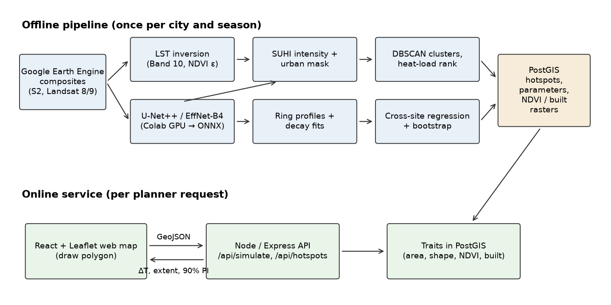
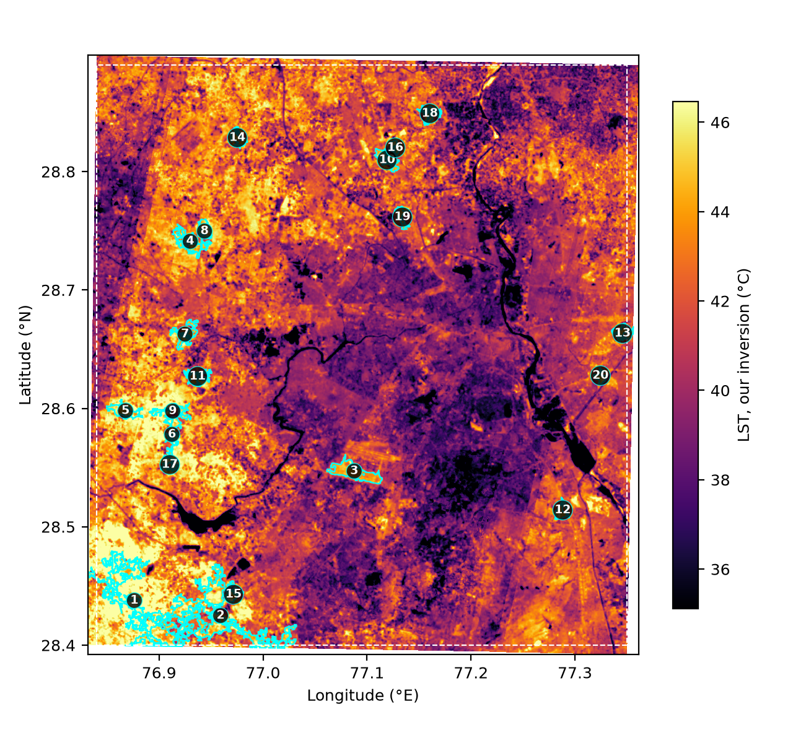
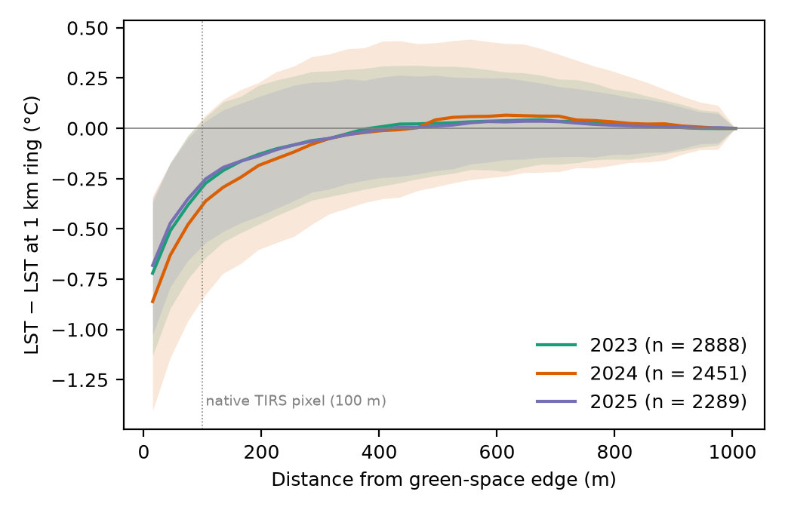

# GeoAI-Based Urban Heat Island and Green Cover Analyzer: From Satellite Thermal Retrieval to Interactive Greening Scenarios

Oct 15, 2026 · Saksham Gupta

> **Status.** E1, E3–E6 and E9 have run on the Delhi exports (runs of 14–15 October 2026; logs in `pipeline/results/` and `pipeline/runs/`). Every number in Results is copied from those logs. E2 (loss and input ablation beyond the CE vs Focal–Dice comparison) and E7 (canopy-gain check) were not run, and no hand-corrected test tiles were produced, so segmentation scores are agreement with weak labels. Two method changes were made after seeing results; both are disclosed where they occur (§4.4, §4.5). Affiliations and the target venue are for the author to add.

## Abstract

Prior work on urban heat solves single stages of the problem. Some papers retrieve Land Surface Temperature (LST), others monitor heat islands, measure how parks cool their surroundings, or explain cooling after the fact. None gives a planner a way to test a proposed green space before it is built. We present an open, decoupled GeoAI platform that joins these stages. It builds cloud-masked Sentinel-2 and Landsat 8/9 summer composites in Google Earth Engine. It retrieves LST from Landsat Band 10 through radiometric inversion with NDVI-based emissivity. A U-Net++ network with an EfficientNet-B4 encoder segments four urban classes, trained with a hybrid Focal–Dice loss. PostGIS ranks contiguous surface heat-island hotspots. A distance-decay cooling model is calibrated on the city's own segmented green spaces and served through a REST API, so a planner can draw a polygon on a web map and get a predicted LST reduction with an uncertainty band. We evaluate the system on Delhi NCT over the 2023–2025 pre-monsoon seasons, holding out 2025 as a temporal transfer test. We report segmentation IoU against U-Net and DeepLabv3+ baselines, LST error against the USGS Collection 2 surface temperature product, hotspot stability, cooling-model error under spatially blocked cross-validation, and API latency. Our single-channel LST runs 6.0–6.8 °C below the USGS product; after removing that offset the error is 0.9–1.5 °C (R² 0.63–0.86). Against weak labels, U-Net++ with Focal–Dice loss has the highest mIoU in all three years (55.8% in 2024) and holds up on unseen 2025 imagery (55.1%). Under spatially blocked cross-validation, the cooling model predicts boundary cooling within 0.8–1.1 °C and its 90% prediction intervals cover 88–90% of held-out sites, but site traits do not improve on a trait-free mean profile for the full distance curve. Hotspot rankings are stable across intensity thresholds within a year (top-20 Spearman ρ 0.65–0.96) but not across years, and many top hotspots fall on peri-urban fallow land. A what-if request is answered in 44 ms at the median and 85 ms at the 95th percentile.

**Keywords:** urban heat island, land surface temperature, semantic segmentation, U-Net++, Google Earth Engine, PostGIS, urban green space, cooling effect, decision support, GeoAI

## 1. Introduction

Surface heat islands are well documented across north Indian cities \[2\], and green space is one of the few levers planners directly control \[3, 4\]. Built surfaces absorb and re-radiate solar energy and reduce evaporative cooling, which produces the surface urban heat island (SUHI). Extreme heat raises health risk, especially for older adults, outdoor workers and people with chronic illness \[20\].

The data needed to study this is free: Landsat thermal bands, Sentinel-2 optical imagery, and cloud platforms such as Google Earth Engine (GEE) \[15\]. The research built on it stops short of planning. Some studies retrieve LST \[1, 5\]. Some publish monitoring dashboards \[2\]. Some measure how existing parks cool their surroundings \[3\]. Some explain cooling after the fact with machine learning \[4\]. A planner who asks "if we plant this 2-hectare plot, how much cooler does the block get?" still has no tool that answers.

This paper builds that tool and tests whether its answers can be trusted. Our contributions are:

1. **An end-to-end, open pipeline.** It runs from raw satellite collections to a web map. GEE compositing, LST inversion, deep land-cover segmentation, PostGIS hotspot ranking and a cooling API run as separate services.
2. **Automatic green-space extraction.** A U-Net++/EfficientNet-B4 model with a Focal–Dice loss maps canopy, built structures, other impervious surfaces and water at 10 m. Green spaces no longer have to be traced by hand, as in \[3\].
3. **A self-calibrating cooling model.** Cooling magnitude and reach are fitted to the city's own segmented green spaces, using concentric-ring LST profiles. The model returns a prediction interval, not just a point estimate, and it is tested under spatially blocked cross-validation.
4. **An interactive what-if service.** A planner draws a polygon and gets a predicted LST reduction and cooling extent in under a second (measured p95: 85 ms).

Section 2 reviews related work. Sections 3–5 describe the data, methods and system. Section 6 sets out the evaluation protocol, Section 7 reports results, and Section 8 discusses limits.

## 2. Related Work

Each of the four studies this work builds on covers one stage of the pipeline. None connects segmentation, LST, hotspot ranking and forward-looking scenarios.

**LST retrieval.** Avdan and Jovanovska \[1\] automated single-channel LST retrieval from Landsat 8. They combined TIRS Band 10 with NDVI-derived emissivity from Bands 4 and 5. Checked against near-surface air temperature, their method showed standard deviations of 2.4 °C and 2.7 °C at two sites. The authors note that air temperature is a weak reference for skin temperature. Ermida et al. \[5\] moved Landsat LST into GEE with a statistical mono-window algorithm and published open code. We follow \[1\] for the inversion. We validate against the USGS Collection 2 Level-2 surface temperature product \[12\], which is physically comparable.

**Cloud-based SUHI monitoring.** Galodha and Gupta \[2\] built a GEE web app for day and night SUHI intensity across northern India (Punjab, Rajasthan, Haryana, Delhi), 2003–2018. It used MODIS and Landsat 5/7/8. Their tool showed that browser-based monitoring is practical. It is observational: it does not classify land cover or test interventions.

**Measured park cooling.** Shah, Garg and Mishra \[3\] traced 262 green spaces in Bengaluru by hand. They measured LST in concentric rings around each one. The average green space was 2.23 °C (95% CI 2.13–2.33) cooler than the point where its effect ended, and its reach averaged 347 m (95% CI 318–376 m). Cooling depended on greenness, size and shape. Their ring method is the basis of our cooling model. We replace the hand tracing with segmentation, so the model can be refitted for any city.

**Explaining cooling with ML.** Kumar et al. \[4\] linked nine Fragstats green-space metrics to Landsat 8 LST across NCT Delhi. They compared Gradient Boosting, Distributed Random Forest and Deep Learning models. Gradient Boosting scored best (R² = 0.886) and was interpreted with SHAP and ICE plots. Fragmented green space ran hotter; connected corridors ran cooler. Their analysis explains current conditions. It does not segment imagery or predict the effect of new green space.

**Segmentation of urban land cover.** U-Net++ \[6\] adds nested, dense skip connections to U-Net \[9\], which narrows the gap between encoder and decoder features. EfficientNet \[7\] scales depth, width and resolution together for better accuracy per parameter. DeepLabv3+ \[8\] is the usual strong baseline for remote-sensing segmentation. Urban scenes are imbalanced: thin tree canopy is rare next to roofs and roads. We therefore pair Focal loss \[10\] with Dice loss \[11\].

| Study | LST retrieval | Land-cover segmentation | Hotspot ranking | Cooling model | What-if scenarios |
| --- | --- | --- | --- | --- | --- |
| Avdan & Jovanovska 2016 \[1\] | Yes | No | No | No | No |
| Galodha & Gupta 2021 \[2\] | Yes (MODIS, Landsat) | No | Maps only | No | No |
| Shah et al. 2021 \[3\] | Yes | Manual tracing | No | Ring regression, observed sites | No |
| Kumar et al. 2026 \[4\] | Yes | Pre-existing map | No | ML + SHAP, observed sites | No |
| **This work** | Yes, validated vs USGS L2 | U-Net++, 4 classes | PostGIS, ranked | Calibrated decay model + intervals | Yes, via API |

## 3. Study Area and Data

The study area is Delhi NCT, taken as the box 76.84–77.35 °E, 28.40–28.89 °N. The box is not clipped to the administrative boundary, so it also covers peri-urban parts of neighbouring Haryana and Uttar Pradesh. Delhi has strong pre-monsoon surface heating, sharp contrasts between green and dense areas, and prior work \[2, 4\] to compare against. The analysis window is the pre-monsoon peak, April to June, for 2023–2025. Models are trained on 2023–2024 and 2025 is held out to test transfer across years. We set our cooling estimates beside the Bengaluru estimates of \[3\] for context only; the two cities differ in climate and urban form.

| Dataset | Use | Resolution | Source |
| --- | --- | --- | --- |
| Sentinel-2 L2A surface reflectance | Segmentation input; NDVI | 10 m (20 m bands resampled) | GEE `COPERNICUS/S2_SR_HARMONIZED` |
| Cloud Score+ for Sentinel-2 | Cloud and shadow masking | 10 m | GEE `GOOGLE/CLOUD_SCORE_PLUS/V1/S2_HARMONIZED` \[13\] |
| Landsat 8/9 Collection 2 Level-1, Band 10 | LST inversion | 100 m native, delivered at 30 m | GEE `LANDSAT/LC08/C02/T1`, `LC09` |
| Landsat 8/9 Collection 2 Level-2, `ST_B10` | LST validation reference | 30 m | USGS \[12\] |
| Landsat `QA_PIXEL` | Cloud, shadow and cirrus masking | 30 m | USGS |
| ESA WorldCover 2021 | Weak labels: tree cover, water, other built-up; rural reference ring | 10 m | \[17\] |
| Google Open Buildings v3 | Weak labels: built structures | Polygons | Google Research \[16\] |

**Labels.** No public 10 m map separates buildings from other paved surfaces in Indian cities. We build weak labels by rasterising Open Buildings footprints with confidence ≥ 0.75 as *Built Structures*, WorldCover built-up pixels outside those footprints as *Impervious*, and WorldCover tree cover and water as *Canopy* and *Water*. Grass, cropland and bare soil fall into an ignore class during training. WorldCover describes 2021, so land that changed after 2021 is mislabelled. The test tiles come from spatial blocks that the training set never touches, but they carry the same weak labels: we planned to correct them by hand against high-resolution imagery and did not. Test scores therefore measure agreement with the weak labels, which is enough to rank models trained on identical data but is not an accuracy figure (Section 7.1).

**Thermal resolution.** TIRS measures at 100 m, and USGS delivers it resampled to 30 m. Cooling extents below about 100 m are therefore not resolved, and we report them only as upper bounds.

## 4. Methodology

The method has five stages: compositing, LST retrieval, segmentation, hotspot ranking and cooling. Each stage writes georeferenced output that the next stage reads.

### 4.1 Cloud-free compositing

For Sentinel-2 we keep pixels with Cloud Score+ `cs_cdf` ≥ 0.60 \[13\]. Cloud Score+ replaces the QA60 bitmask proposed in the synopsis, because QA60 is masked out for imagery from 25 January 2022 to 28 February 2024 \[21\]; the 0.60 threshold sits within the 0.50–0.65 range the dataset documentation recommends. For Landsat we drop pixels whose `QA_PIXEL` flags fill, dilated cloud, cirrus, cloud or cloud shadow (bits 0–4). Scenes with more than 15% cloud are excluded first. Each band is then reduced to its per-pixel median over all clear observations in the window:

```latex
\tilde{x}(i,j) = \operatorname{median}\{\, x_t(i,j) : m_t(i,j) = 1,\; t \in T \,\}
```

Here m is the clear-sky mask and T is the set of acquisitions from April to June.

### 4.2 LST retrieval

We follow the single-channel steps of \[1\] on Landsat Band 10. Digital numbers become top-of-atmosphere radiance, then brightness temperature:

```latex
L_\lambda = M_L \, Q_{cal} + A_L, \qquad T_B = \frac{K_2}{\ln\!\left( K_1 / L_\lambda + 1 \right)}
```

M\_L, A\_L, K\_1 and K\_2 are read from each scene's metadata (RADIANCE\_MULT\_BAND\_10, RADIANCE\_ADD\_BAND\_10, K1\_CONSTANT\_BAND\_10, K2\_CONSTANT\_BAND\_10) rather than hard-coded \[1\]. Emissivity comes from the vegetation proportion \[1, 14\]:

```latex
P_v = \left( \frac{NDVI - NDVI_s}{NDVI_v - NDVI_s} \right)^{2}, \qquad \varepsilon = 0.004\,P_v + 0.986
```

We use the NDVI thresholds NDVI\_s = 0.2 and NDVI\_v = 0.5 of \[14\], with P\_v clipped to \[0, 1\]. Pixels the segmentation labels *Water* take a fixed ε = 0.991. This is an assumed value: we did not find a primary source we could verify for it, and water is excluded from both hotspot and cooling statistics, so it affects only the displayed map. LST in °C is then:

```latex
LST = \frac{T_B}{1 + \left( \lambda \, T_B / \rho \right) \ln \varepsilon} - 273.15
```

Here λ = 10.895 µm, the midpoint of the Band 10 passband (10.60–11.19 µm) \[23\], and ρ = hc/k\_B ≈ 1.4388 × 10⁻² m·K. This scheme has no water-vapour correction, so we expect a systematic bias against the USGS Level-2 product \[12\]. We report that bias separately from RMSE. Hotspot ranking and cooling use LST *differences* within one scene date, and a scene-wide bias cancels out of those. The platform can use either our inversion or the USGS product; Section 7 compares the two.

### 4.3 Land-cover segmentation

The input to the network is a seven-channel 10 m tile: Sentinel-2 B2, B3, B4, B8, B11, B12 and NDVI, standardised per channel. The model is U-Net++ \[6\] with an ImageNet-pretrained EfficientNet-B4 encoder \[7\]. The first convolution is widened from 3 to 7 channels by cycling its pretrained RGB filters across the new channels and scaling them by 3/7, as segmentation-models-pytorch does \[24\]. The output is four classes plus an ignore index. The loss is:

```latex
\mathcal{L} = \alpha \, \mathcal{L}_{focal} + (1-\alpha)\, \mathcal{L}_{dice}, \quad \mathcal{L}_{focal} = -\sum_c w_c (1-p_c)^{\gamma} y_c \log p_c, \quad \mathcal{L}_{dice} = 1 - \frac{1}{C}\sum_c \frac{2\sum p_c y_c + \epsilon}{\sum p_c + \sum y_c + \epsilon}
```

We use γ = 2 and α = 0.5, with class weights w\_c set to inverse square-root class frequency. Training uses AdamW (learning rate 3 × 10⁻⁴, cosine decay), batches of 16 tiles of 256 × 256 pixels, and flips, 90° rotations and a random ±10% scaling of the standardised input. The model is exported to ONNX for CPU inference over the full city.

### 4.4 Hotspot ranking

SUHI intensity is each pixel's LST minus the median LST of a rural reference ring. The ring runs 5–15 km outside the study box and keeps only WorldCover shrubland, grassland and cropland pixels:

```latex
I(i,j) = LST(i,j) - \operatorname{median}_{(k,l) \in R} LST(k,l)
```

Only pixels in the urban fabric are eligible: the share of the 30 m cell that the segmentation labels *Built* or *Impervious* must be at least 0.5. Eligible pixels with I ≥ 2.0 °C are turned into polygons. ST\_ClusterDBSCAN (eps = 60 m, minpoints = 1) merges neighbouring fragments. Clusters smaller than 5000 m² are dropped. The rest are ranked by heat load, mean I × area. The 2.0 °C and 5000 m² thresholds come from the synopsis. They are settings, not physical constants, and Section 7 tests how sensitive the ranking is to them.

**Post-hoc change.** The urban mask was not in the original design. We added it after the first run, when the unmasked definition ranked fallow fields on the city fringe as the largest hotspots (Section 7.3). The 0.5 fraction was chosen once and not tuned. We report both runs.

### 4.5 Cooling model

The synopsis proposed ΔLST = θ₁ ln(Area) + θ₂ ΔNDVI + θ₃ Dist. That form is linear in distance, so cooling would never fade out. We keep its predictors but let cooling decay with distance, in line with the ring analysis of \[3\].

**Step 1: per-site profiles.** Each connected *Canopy* patch of at least 0.5 ha is a calibration site. Around each site we draw 30 m rings out to 1 km. Each ring's mean LST excludes water and other canopy patches. We fit:

```latex
LST_g(d) = LST_{g,\infty} - \Delta T_g \, e^{-d/\ell_g}
```

ΔT\_g is the cooling at the site boundary and ℓ\_g is its decay length. The fit searches ℓ in \[10, 3000\] m. A fit within 2% of either bound does not identify ℓ: at the lower bound the cooling is shorter than one ring, at the upper bound the profile never levels off inside 1 km. Such sites are excluded from calibration and counted (Section 7.4). The cooling extent is the distance where cooling falls below 0.5 °C, d\* = ℓ ln(ΔT / 0.5), capped at the 1 km edge of the rings, since beyond it the fit would be extrapolating.

**Post-hoc change.** The bound-margin exclusion and the 1 km cap were added after the first calibration run. In that run, fits that ended a hair inside the search bounds passed a strict bounds check and produced extents of 4–5 km, extrapolated far past the data. All cooling results reported here use the corrected rule.

**Step 2: cross-site regression.** Both quantities are regressed on site traits:

```latex
\Delta T_g = \theta_0 + \theta_1 \ln A_g + \theta_2 \, NDVI_g + \theta_3 \, LSI_g + \theta_4 \, B_g + \varepsilon_g, \qquad \ln \ell_g = \phi_0 + \phi_1 \ln A_g + \phi_2 \, NDVI_g + \eta_g
```

A\_g is area, LSI\_g is the landscape shape index and B\_g is the built fraction within 300 m. As a nonlinear alternative we fit gradient-boosted trees on the same predictors.

**Step 3: prediction for a drawn polygon.** The planner supplies a target NDVI or picks a planting preset. The service computes A, LSI and B with PostGIS and predicts ΔT and ℓ. It returns the cooling profile ΔT̂ e^{−d/ℓ̂} as ring polygons. A 90% prediction interval comes from 1000 bootstrap refits over sites. The new green space only cools as far as its NDVI change allows, so ΔT̂ is scaled by the fraction (NDVI\_target − NDVI\_now) / (NDVI\_target − NDVI\_s), floored at zero.

## 5. System Architecture and Implementation

All heavy raster work runs offline once per city and season. A planner's request only touches PostGIS and a small cooling model, which is what keeps the what-if loop interactive.



The offline pipeline writes rasters, hotspot polygons and fitted cooling parameters to PostGIS. The online API reads only those tables. It never loads the neural network or calls Earth Engine during a request.

| Component | Technology | Input | Output |
| --- | --- | --- | --- |
| Compositing | GEE Python API | Image collections, city boundary | 10 m optical and 30 m thermal GeoTIFFs |
| LST inversion | NumPy, Rasterio | Band 10 DN, scene metadata, NDVI | LST GeoTIFF (°C) |
| Segmentation | PyTorch, segmentation-models-pytorch, ONNX Runtime | 7-channel tiles | 4-class map GeoTIFF |
| Hotspots and calibration | PostGIS 3, SciPy, scikit-learn | LST and class rasters | Ranked hotspot polygons; cooling coefficients and bootstrap samples |
| Cooling API | Node.js 20, Express, `pg` | GeoJSON polygon, target NDVI | Predicted ΔT, extent, 90% interval, ring GeoJSON |
| Web map | React, Leaflet | API responses, LST overlay | Interactive dashboard with polygon drawing |

All services run in Docker Compose. A workstation GPU is needed only for training. Inference and serving run on CPU.

## 6. Experimental Design and Evaluation Protocol

Every component is tested against a reference it was not trained on. Splits are spatial, because neighbouring pixels are correlated and random splits overstate accuracy \[19\].

| Experiment | Question | Reference | Metrics | Split |
| --- | --- | --- | --- | --- |
| E1 Segmentation benchmark | Does U-Net++/EffNet-B4 + Focal–Dice beat standard baselines? | Weak labels on held-out blocks (hand correction not done) | mIoU, per-class IoU, F1, overall accuracy | 2.56 km spatial blocks (one tile each), 70/15/15 |
| E2 Loss and input ablation | What do the hybrid loss, the SWIR bands and NDVI each add? | Same test tiles | Change in mIoU and Canopy IoU | Same as E1; only the loss comparison was run |
| E3 Temporal transfer | Does a model trained on 2023–24 hold up on 2025 imagery? | 2025 test tiles | mIoU, Canopy IoU | Train 2023–24, test 2025, same held-out blocks |
| E4 LST accuracy | How close is our inversion to the operational product? | USGS L2 `ST_B10` | Bias, MAE, RMSE, R² (°C), per class | All clear pixels, 3 summers |
| E5 Hotspot stability | Do the ranked hotspots change with thresholds or year? | Itself, varied | Jaccard overlap of top-20; Spearman ρ of rank | 2023 vs 2024 vs 2025; I ∈ {1.5, 2, 2.5} °C |
| E6 Cooling model accuracy | Can we predict a site's cooling from its traits? | Observed ring profiles | MAE of ΔT (°C), MAE of extent (m), 90% PI coverage | Leave-one-block-out CV, 2 km blocks |
| E7 Change-based check | Does predicted cooling match LST change where canopy actually grew? | Sites with canopy gain 2016→2024 | Predicted vs observed ΔLST, MAE | Not run (Section 8) |
| E8 Context from prior work | How do Delhi estimates compare with Bengaluru \[3\]? | Published 2.23 °C, 347 m | Mean ΔT and extent with 95% CI | All Delhi sites; a comparison, not a test of agreement |
| E9 System performance | Is the what-if loop interactive? | — | p50/p95 API latency | 1000 random polygons, 0.1–50 ha |

**Baselines for E1.** U-Net with a ResNet-34 encoder and DeepLabv3+ with a ResNet-50 encoder, both trained with cross-entropy on the same data. U-Net++/EffNet-B4 with cross-entropy separates the effect of the architecture from the effect of the loss.

**Baselines for E6.** The synopsis's linear form (ΔLST = θ₁ ln A + θ₂ ΔNDVI + θ₃ d) and a constant model that predicts the sample mean. The decay model must beat both to justify itself.

**Statistics.** Segmentation scores are reported as mean ± SD over 3 random seeds. A paired bootstrap over test tiles was planned for model comparisons but not run; differences smaller than about one point should be read as ties.

## 7. Results

All numbers below are copied from the experiment logs of one end-to-end run (Colab, NVIDIA T4). Segmentation runs used 834 tiles (573 train, 126 validation, 135 test, 45 test tiles per year).

### 7.1 Segmentation (E1–E3)

**Caveat.** No hand-corrected test tiles were produced, so every score below is agreement with the *weak* labels on held-out blocks, not accuracy. The weak labels contain systematic errors (Section 3), so these numbers rank models trained on the same data; they are not accuracy figures.

Test year 2024, mean ± SD over 3 seeds (%):

| Model | Encoder | Loss | mIoU | Built IoU | Impervious IoU | Canopy IoU | Water IoU | OA |
| --- | --- | --- | --- | --- | --- | --- | --- | --- |
| U-Net | ResNet-34 | CE | 52.4 ± 0.3 | 22.3 ± 1.4 | 62.7 ± 0.6 | 74.2 ± 1.0 | 50.5 ± 1.2 | 73.7 ± 0.4 |
| DeepLabv3+ | ResNet-50 | CE | 49.1 ± 0.3 | 9.9 ± 2.3 | 61.6 ± 0.5 | 72.0 ± 0.5 | 53.1 ± 0.4 | 71.6 ± 0.2 |
| U-Net++ | EffNet-B4 | CE | 54.6 ± 0.2 | 25.3 ± 1.5 | 63.1 ± 0.4 | 74.9 ± 0.1 | 55.3 ± 1.7 | 74.3 ± 0.2 |
| U-Net++ (ours) | EffNet-B4 | Focal + Dice | 55.8 ± 0.1 | 36.2 ± 0.1 | 56.8 ± 0.5 | 75.3 ± 0.1 | 54.8 ± 0.4 | 72.5 ± 0.3 |

mIoU by test year (2025 imagery was never seen in training):

| Model | 2023 | 2024 | 2025 (transfer) |
| --- | --- | --- | --- |
| U-Net / ResNet-34, CE | 55.4 ± 0.2 | 52.4 ± 0.3 | 52.9 ± 1.0 |
| DeepLabv3+ / ResNet-50, CE | 50.5 ± 0.4 | 49.1 ± 0.3 | 48.3 ± 0.2 |
| U-Net++ / EffNet-B4, CE | 56.6 ± 0.3 | 54.6 ± 0.2 | 54.3 ± 0.3 |
| U-Net++ / EffNet-B4, Focal + Dice (ours) | 57.4 ± 0.2 | 55.8 ± 0.1 | 55.1 ± 0.3 |

The ranking is the same in every year, and the drop from 2024 to 2025 is under one point for the U-Net++ models. The hybrid loss changes *which* errors the model makes more than how many. It lifts Built IoU by about 11 points over cross-entropy, the rare class it was chosen for, and costs about 6 points of Impervious IoU and 2 points of overall accuracy. Built vs Impervious is the weakest boundary, as expected at 10 m. DeepLabv3+ nearly gives up on the Built class (IoU below 10%). Paired bootstrap tests and the E2 input ablation have not been run.

### 7.2 LST accuracy (E4)

| Comparison | Bias (°C) | MAE (°C) | RMSE (°C) | R² | Pixels |
| --- | --- | --- | --- | --- | --- |
| Our inversion vs USGS L2, all pixels | −6.78 / −5.98 / −6.21 | 6.78 / 5.98 / 6.21 | 7.03 / 6.12 / 6.31 | < 0 | 3.12 M per year |
| Built / Impervious only | −7.00 / −5.70 / −5.94 | 7.00 / 5.70 / 5.94 | 7.19 / 5.81 / 6.00 | < 0 | 1.33–1.49 M |
| Canopy only | −6.56 / −6.07 / −6.34 | 6.56 / 6.07 / 6.34 | 6.83 / 6.20 / 6.45 | < 0 | 1.35–1.53 M |
| After removing the mean bias | 0 | 1.47 / 1.03 / 0.89 | 1.85 / 1.31 / 1.11 | 0.63 / 0.86 / 0.85 | 3.12 M per year |

Values are 2023 / 2024 / 2025. Our inversion is 6–7 °C colder than the USGS product everywhere, in built and canopy pixels alike. That is the expected sign and size for skipping atmospheric correction in a hot, hazy pre-monsoon atmosphere: the atmosphere absorbs part of the surface signal and emits at a lower temperature. Because the offset is nearly the same across classes, the spatial pattern survives. After removing it, the residual error is about 1–1.5 °C and R² reaches 0.85–0.86 in 2024–2025 (0.63 in 2023). R² is negative before debiasing because of the offset alone. For anything that needs absolute temperatures, the USGS product should be used; for hotspot ranking and cooling, which use within-scene differences, our inversion is adequate.

### 7.3 Hotspots (E5)

**First run, no urban mask.** At I ≥ 2 °C the pixel step produced 1494, 2262 and 958 candidate regions in 2023, 2024 and 2025. For 2024, clustering and the 0.5 ha cut left 1252 ranked hotspots. The three largest covered 13,227, 10,212 and 9,916 ha on the western and southern fringe, over dry fallow fields and bare ground. Peng et al. \[25\] found that a few cities surrounded by desert are cooler than their surroundings by day; Delhi's dry pre-monsoon fallow land plays the part of that desert here, so a definition that compares every pixel with a rural reference flags open land as "urban" heat. This run motivated the urban mask (§4.4).

**With the urban mask.** Hotspot counts after clustering and the 0.5 ha cut:

| Year | I ≥ 1.5 °C | I ≥ 2.0 °C | I ≥ 2.5 °C |
| --- | --- | --- | --- |
| 2023 | 1109 | 811 | 543 |
| 2024 | 1777 | 1559 | 1278 |
| 2025 | 799 | 579 | 371 |

The largest 2024 hotspots are now 1414 ha (mean I = 4.4 °C) and 1501 ha (3.5 °C), both in the south-west corner of the box near 76.88–76.96 °E, 28.43 °N, followed by 438 ha (2.7 °C) near 77.09 °E, 28.55 °N and a string of 100–300 ha clusters on the western edge (Figure 2). The mask removes the 10,000 ha fringe blobs, but it does not fully remove open land. Of the 2024 pixels that pass the mask and exceed 2 °C, WorldCover 2021 calls 51% cropland and 27% built-up (2023: 72% and 19%; 2025: 46% and 34%). Some of this is real conversion of farmland after 2021, which is common on Delhi's edge, but much is likely dry fallow soil that our segmentation labels *Impervious*: the two are spectrally close in the pre-monsoon season, and the weak labels never show the network bare soil as a separate class. The two largest hotspots also lie outside NCT Delhi, in the Haryana part of the box.



**Stability (E5).** We compare the top-20 hotspots of two runs by area Jaccard overlap, and by Spearman ρ between the ranks of each top-20 hotspot and its best-overlapping match in the other run:

| Comparison | Jaccard (top-20 area) | Spearman ρ | Matched of 20 |
| --- | --- | --- | --- |
| 2023 vs 2024 (I ≥ 2 °C) | 0.04 | 0.04 | 18 |
| 2023 vs 2025 | 0.04 | 0.01 | 11 |
| 2024 vs 2025 | 0.17 | 0.61 | 17 |
| 2023: 2.0 vs 1.5 °C | 0.54 | 0.66 | 20 |
| 2023: 2.0 vs 2.5 °C | 0.54 | 0.79 | 20 |
| 2024: 2.0 vs 1.5 °C | 0.63 | 0.69 | 20 |
| 2024: 2.0 vs 2.5 °C | 0.69 | 0.82 | 20 |
| 2025: 2.0 vs 1.5 °C | 0.60 | 0.96 | 20 |
| 2025: 2.0 vs 2.5 °C | 0.62 | 0.65 | 20 |

Within a year, the ranking is robust to the threshold: every top-20 hotspot has a counterpart, about 55–70% of the top-20 area is shared, and ρ is 0.65–0.96. Across years it is not. The 2023 top 20 shares 4% of its area with either later year, and only 2024 and 2025 agree moderately (ρ = 0.61). Year-to-year swings in which fields lie fallow at the time of the clear Landsat scenes are a plausible cause, consistent with the cropland share above. A single season's ranking should therefore not be used alone to target interventions; a multi-year persistence filter is the obvious next step.

### 7.4 Cooling model (E6–E8)

**Calibration sites.** Of 5196 / 4904 / 4039 candidate green spaces (2023 / 2024 / 2025), 1504 / 1688 / 1099 had a decay length at the lower search bound (cooling confined to the first 30 m ring) and 797 / 752 / 626 at the upper bound (no levelling off within 1 km). A further 7 / 13 / 25 could not be fitted. That leaves 2888 / 2451 / 2289 calibration sites. The excluded sites are not random: the model describes green spaces whose cooling is measurable at 30 m over 1 km, which is about half of them.

Ten-fold spatial cross-validation on 2 km blocks, 2023 / 2024 / 2025:

| Model | Profile MAE (°C) | ΔT MAE (°C) | Extent MAE (m) | 90% PI coverage |
| --- | --- | --- | --- | --- |
| Mean profile, no site traits | 0.275 / 0.368 / 0.239 | — | — | — |
| Linear, synopsis form | 0.293 / 0.386 / 0.255 | — | — | — |
| Exponential decay + linear traits (ours) | 0.288 / 0.380 / 0.254 | 0.84 / 1.10 / 1.02 | 159 / 192 / 150 | 0.90 / 0.885 / 0.89 |
| Exponential decay + boosted trees | 0.286 / 0.381 / 0.249 | 0.77 / 1.10 / 0.84 | 161 / 196 / 151 | — |

The decay form beats the synopsis's linear-in-distance form in every year, but **neither trait-based model beats the trait-free mean profile** on the full distance curve. Site area, NDVI, shape and surrounding built fraction explain little of how cooling varies with distance. Across sites, the fitted area coefficient on ΔT is near zero (−0.04 to 0.02 °C per ln m²). The surrounding built fraction (−3.2 to −4.9 °C per unit) and NDVI (2.1 to 3.1 °C per unit) carry the signal. Where the model adds value is boundary cooling with an honest interval: the 90% prediction intervals cover 88.5–90.2% of held-out sites. Boosted trees improve ΔT error in 2023 and 2025 and tie in 2024.



Delhi beside \[3\]: mean ΔT = 1.40 °C (95% CI 1.34–1.47) in 2023, 1.74 °C (1.65–1.83) in 2024 and 1.40 °C (1.30–1.50) in 2025. Mean extent = 175 m (165–185), 215 m (203–227) and 161 m (150–172); medians 60, 81 and 49 m; 5–8% of sites reach the 1 km cap. Shah et al. report 2.23 °C and 347 m for Bengaluru. Delhi's measurable cooling is both weaker and shorter, though \[3\] defines extent from the turning point of each profile rather than a 0.5 °C threshold, so the comparison is context, not a test. Medians below 100 m sit under the native thermal resolution and should be read as upper bounds.

### 7.5 System performance (E9)

We sent 1000 sequential `/api/simulate` requests for random star-shaped polygons of 0.1–50 ha (log-uniform area, fixed seed) inside the study box, after 20 warm-up requests, from the same laptop (Apple M4, PostGIS 16 in Docker) against the 2024 model. All 1000 succeeded. Round-trip latency was p50 = 44 ms and p95 = 85 ms (maximum 263 ms); the server's own timing was 43 and 82 ms, so almost all of it is PostGIS trait extraction and ring building. The top-50 hotspot query took 45 ms (p50) and 50 ms (p95). A network hop to a remote server would add to these figures. Full-city segmentation via ONNX Runtime on the Colab CPU took 3.8–3.9 min per year (783 overlapping 256 px windows).

## 8. Discussion and Limitations

Three results shape how the platform should be described. First, single-channel LST without atmospheric correction is biased by 6–7 °C in Delhi's pre-monsoon atmosphere but preserves the spatial pattern, so it suits relative questions, not absolute ones. Second, the cooling model's useful output is boundary cooling with a calibrated interval; it does not predict the shape of the distance curve better than a city-wide average. A planner should read the extent as indicative. Third, a large share of Delhi's green spaces show no cooling resolvable at Landsat scale, and the model says nothing about them. The limits below also apply.

- **Surface vs air temperature.** The system predicts land surface (skin) temperature, not the air temperature people feel. The two are related but not equal. A predicted LST drop indicates relief from surface heat, not a forecast of pedestrian-level weather.
- **Space-for-time substitution.** The cooling model learns from existing green spaces and assumes a new one will behave like an existing one with the same traits. A newly planted site takes years to reach the canopy and NDVI of a mature park. The planned check against sites where canopy actually grew (E7) was not run, so this assumption is untested.
- **Correlation, not physics.** The regression captures association. It is a screening tool for comparing options quickly. It does not replace 3-D microclimate models such as ENVI-met for final design.
- **Resolution.** The thermal band is 100 m native. Cooling extents and small pocket parks below about one thermal pixel cannot be resolved. Between 27% and 34% of candidate green spaces had cooling confined to the first 30 m ring and were left out of calibration.
- **Hotspot definition.** Without an urban mask, the hotspot step flags dry bare land on the city fringe. The mask added after the first run (a disclosed post-hoc change) removes the largest of these but relies on the segmentation, which confuses fallow soil with impervious surface; about half of the masked hot pixels are cropland in WorldCover 2021. The ranking is stable across thresholds but not across years (Section 7.3).
- **Study extent.** The box is not clipped to the NCT boundary, and the top two 2024 hotspots lie in Haryana.
- **Weak labels.** Training labels come from Open Buildings footprints and WorldCover 2021, both of which contain errors, and WorldCover predates our imagery. The test tiles carry the same weak labels, so segmentation scores rank models but are not accuracy. A hand-corrected test set, a paired significance test and the input ablation (E2) remain to be done.
- **Single season, single overpass time.** Landsat 8/9 pass mid-morning (about 10:00 local solar time) \[22\], and the window is pre-monsoon. Night-time and monsoon cooling are out of scope.
- **Configuration effects.** Kumar et al. \[4\] show that how green space is arranged matters, not only how much. We include a shape index but not full connectivity metrics.

**Future work.** First, hand-correct the test tiles, add a bare-soil class to the labels, and run the canopy-gain check (E7). Second, rank hotspots by multi-year persistence and clip them to the administrative boundary. Third, add patch-cohesion and edge-density metrics computed live in PostGIS for drawn layouts, building on \[4\]. Fourth, return SHAP-style explanations alongside each prediction, add night-time LST from ECOSTRESS or MODIS, and weight hotspot rank by population exposure.

## 9. Conclusion

The platform turns open satellite data into answers a planner can act on: where the city is hottest, and how much a proposed green space would cool it, with an honest error band. It joins four strands of earlier work: LST retrieval \[1\], cloud-based monitoring \[2\], measured park cooling \[3\] and configuration-aware analysis \[4\]. It adds automatic green-space segmentation and a cooling model calibrated per city and tested on held-out areas. On Delhi, it predicts a green space's boundary cooling to within about 1 °C with well-calibrated 90% intervals, while showing that site traits do not yet explain how far cooling reaches. It answers a what-if request in under 0.1 s. Its hotspot ranking is robust to threshold choice but changes from year to year, and it still mixes fallow land into the urban fabric, so it should guide inspection rather than investment. The code is released at https://github.com/skshmgpt/uhi-geoai.

**Disclosure.** An AI assistant (Claude, Anthropic) helped write the code, run the experiments and draft the text. Every number in Section 7 comes from the logged runs in the repository. The author checked the content and takes responsibility for it, consistent with IEEE and COPE guidance on generative AI. Two method changes were made after seeing results (§4.4, §4.5) and are reported as such.

## References

1. U. Avdan and G. Jovanovska, "Algorithm for automated mapping of land surface temperature using LANDSAT 8 satellite data," *Journal of Sensors*, vol. 2016, Art. 1480307, 2016, doi: [10.1155/2016/1480307](https://doi.org/10.1155/2016/1480307).
2. A. Galodha and S. K. Gupta, "Land surface temperature as an indicator of urban heat island effect: A Google Earth Engine based web-app," *Int. Arch. Photogramm. Remote Sens. Spatial Inf. Sci.*, vol. XLIV-M-3-2021, pp. 57–62, 2021, doi: [10.5194/isprs-archives-XLIV-M-3-2021-57-2021](https://isprs-archives.copernicus.org/articles/XLIV-M-3-2021/57/2021/).
3. A. Shah, A. Garg, and V. Mishra, "Quantifying the local cooling effects of urban green spaces: Evidence from Bengaluru, India," *Landscape and Urban Planning*, vol. 209, Art. 104043, 2021, doi: [10.1016/j.landurbplan.2021.104043](https://www.sciencedirect.com/science/article/abs/pii/S0169204621000062).
4. M. Kumar *et al.*, "Role of urban green space structure and configuration in regulating land surface temperature in NCT Delhi using explainable artificial intelligence," *Urban Climate*, vol. 65, Art. 102736, 2026, doi: [10.1016/j.uclim.2025.102736](https://www.sciencedirect.com/science/article/pii/S2212095525004523). \[Co-author list to confirm on the publisher page.\]
5. S. L. Ermida, P. Soares, V. Mantas, F.-M. Göttsche, and I. F. Trigo, "Google Earth Engine open-source code for land surface temperature estimation from the Landsat series," *Remote Sensing*, vol. 12, no. 9, Art. 1471, 2020, doi: 10.3390/rs12091471.
6. Z. Zhou, M. M. R. Siddiquee, N. Tajbakhsh, and J. Liang, "UNet++: A nested U-Net architecture for medical image segmentation," in *DLMIA 2018*, LNCS vol. 11045, Springer, 2018, pp. 3–11, doi: [10.1007/978-3-030-00889-5\_1](https://arxiv.org/abs/1807.10165).
7. M. Tan and Q. V. Le, "EfficientNet: Rethinking model scaling for convolutional neural networks," in *Proc. ICML*, PMLR vol. 97, 2019, pp. 6105–6114.
8. L.-C. Chen, Y. Zhu, G. Papandreou, F. Schroff, and H. Adam, "Encoder-decoder with atrous separable convolution for semantic image segmentation," in *Proc. ECCV*, 2018, pp. 801–818.
9. O. Ronneberger, P. Fischer, and T. Brox, "U-Net: Convolutional networks for biomedical image segmentation," in *MICCAI 2015*, LNCS vol. 9351, Springer, 2015, pp. 234–241.
10. T.-Y. Lin, P. Goyal, R. Girshick, K. He, and P. Dollár, "Focal loss for dense object detection," in *Proc. ICCV*, 2017, pp. 2980–2988.
11. F. Milletari, N. Navab, and S.-A. Ahmadi, "V-Net: Fully convolutional neural networks for volumetric medical image segmentation," in *Proc. 3DV*, 2016, pp. 565–571.
12. U.S. Geological Survey, *Landsat 8–9 Collection 2 Level 2 Science Product Guide*, USGS EROS.
13. V. J. Pasquarella, C. F. Brown, W. Czerwinski, and W. J. Rucklidge, "Comprehensive quality assessment of optical satellite imagery using weakly supervised video learning," in *Proc. IEEE/CVF CVPR Workshops*, 2023, pp. 2125–2135, doi: 10.1109/CVPRW59228.2023.00206. Dataset page: [Cloud Score+](https://developers.google.com/earth-engine/datasets/catalog/GOOGLE_CLOUD_SCORE_PLUS_V1_S2_HARMONIZED).
14. J. A. Sobrino, J. C. Jiménez-Muñoz, and L. Paolini, "Land surface temperature retrieval from LANDSAT TM 5," *Remote Sensing of Environment*, vol. 90, no. 4, pp. 434–440, 2004.
15. N. Gorelick, M. Hancher, M. Dixon, S. Ilyushchenko, D. Thau, and R. Moore, "Google Earth Engine: Planetary-scale geospatial analysis for everyone," *Remote Sensing of Environment*, vol. 202, pp. 18–27, 2017.
16. W. Sirko *et al.*, "Continental-scale building detection from high resolution satellite imagery," arXiv:2107.12283, 2021.
17. D. Zanaga *et al.*, *ESA WorldCover 10 m 2021 v200*, Zenodo, 2022, doi: 10.5281/zenodo.7254221.
18. M. Ester, H.-P. Kriegel, J. Sander, and X. Xu, "A density-based algorithm for discovering clusters in large spatial databases with noise," in *Proc. KDD*, 1996, pp. 226–231.
19. D. R. Roberts *et al.*, "Cross-validation strategies for data with temporal, spatial, hierarchical, or phylogenetic structure," *Ecography*, vol. 40, no. 8, pp. 913–929, 2017.
20. World Health Organization, "Heat and health," fact sheet, 2026. \[Online\]. Available: [who.int](https://www.who.int/news-room/fact-sheets/detail/climate-change-heat-and-health)
21. Google Earth Engine Data Catalog, "Harmonized Sentinel-2 MSI: MultiSpectral Instrument, Level-2A (SR)." \[Online\]. Available: [developers.google.com](https://developers.google.com/earth-engine/datasets/catalog/COPERNICUS_S2_SR_HARMONIZED)
22. U.S. Geological Survey, "What are the acquisition schedules for the Landsat satellites?" FAQ. \[Online\]. Available: [usgs.gov](https://usgs.gov/faqs/what-are-acquisition-schedules-landsat-satellites)
23. U.S. Geological Survey, *Landsat 8 (L8) Data Users Handbook*, LSDS-1574, USGS EROS, 2019. \[Online\]. Available: [usgs.gov](https://www.usgs.gov/landsat-missions/landsat-8-data-users-handbook)
24. P. Iakubovskii, "Segmentation Models Pytorch," GitHub repository, 2019. \[Online\]. Available: [github.com/qubvel/segmentation\_models.pytorch](https://github.com/qubvel/segmentation_models.pytorch)
25. S. Peng *et al.*, "Surface urban heat island across 419 global big cities," *Environmental Science & Technology*, vol. 46, no. 2, pp. 696–703, 2012, doi: 10.1021/es2030438.
